<div align="center">

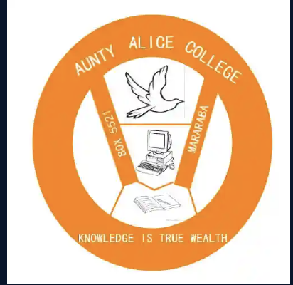

# Aunty Alice College

### Premium School Website Demo

*Knowledge is True Wealth: a warm, cinematic digital experience for a college in Mararaba.*

<br>

    

[**View the repository →**](https://github.com/hello2Nacho/auntyalice-premium-school-demo)

<br>

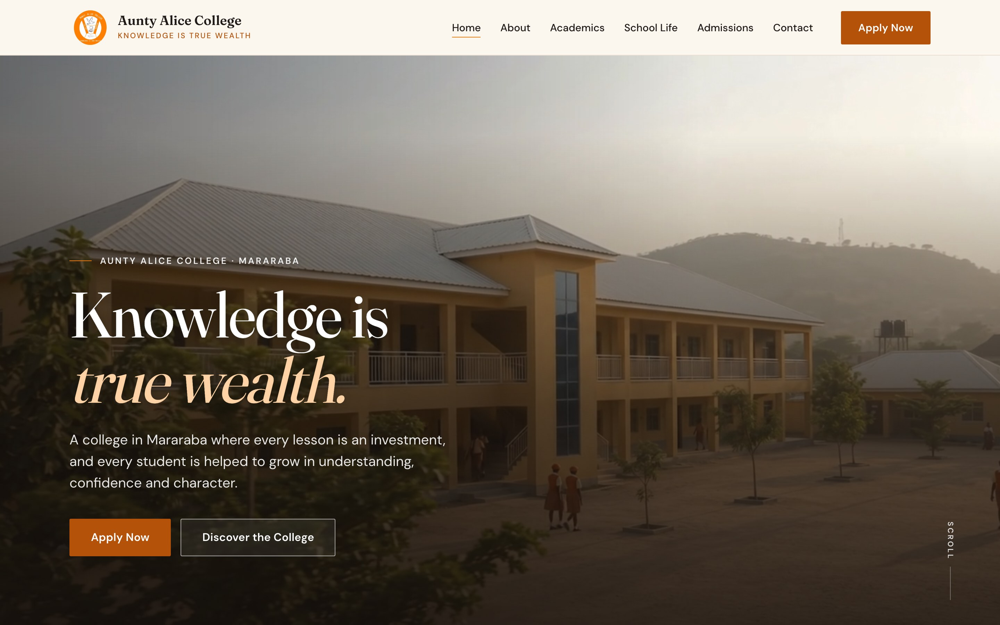

</div>

<br>

---

## ◆ Overview

A premium website concept for **Aunty Alice College, Mararaba**. It shows how a school with little digital presence can be presented through a sophisticated, modern web experience that stays true to its real identity.

The project brings together:

- a cinematic hero video of the college campus
- photography generated to match the school's real uniform, colours and buildings
- editorial typography and generous whitespace
- responsive layouts, composed for every screen size
- storytelling built around the school's own motto and crest
- an admissions section and a demo application portal

---

## ◆ The Experience

| | |
|---|---|
| 🎬 **Cinematic Hero** | Full-viewport campus video with the motto as the headline |
| 📖 **Our Philosophy** | *Knowledge is True Wealth*, read through the three symbols of the crest |
| 🏫 **About the College** | An editorial introduction with key facts about the college |
| 📝 **Admissions** | An invitation to apply, with the five application steps |
| 🎓 **Academics** | Nursery & Day Care, Secondary College, and life in every classroom |
| 🌱 **School Life** | Friendship, conduct and pride in the orange-and-yellow uniform |
| 🏛️ **Our Campus** | The two-storey classroom block, bright classrooms and open compound |
| ✉️ **Stay in Touch** | A demo newsletter sign-up and the college's contact details |
| 💻 **Admissions Portal** | A five-step demo application, from student details to review |
| 🔗 **Institutional Footer** | Crest, motto, address and site links |

<br>

<table>
  <tr>
    <td width="50%">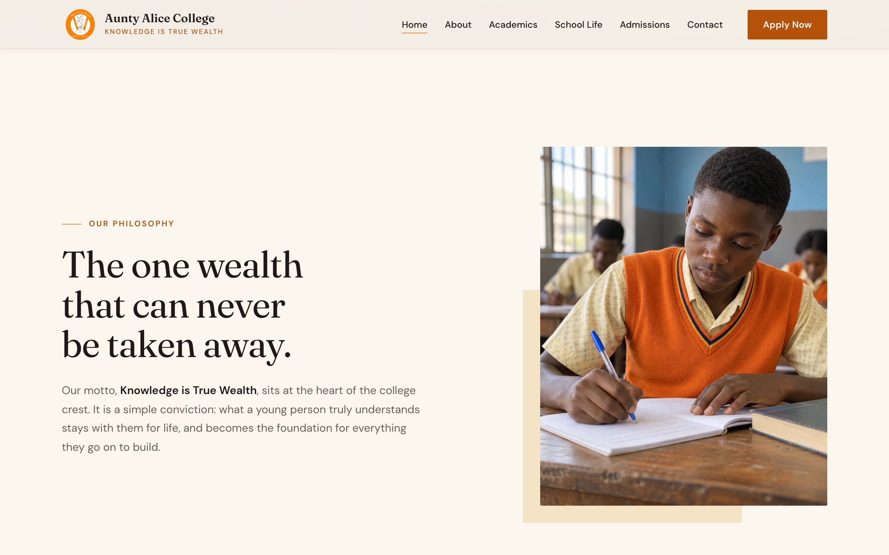</td>
    <td width="50%">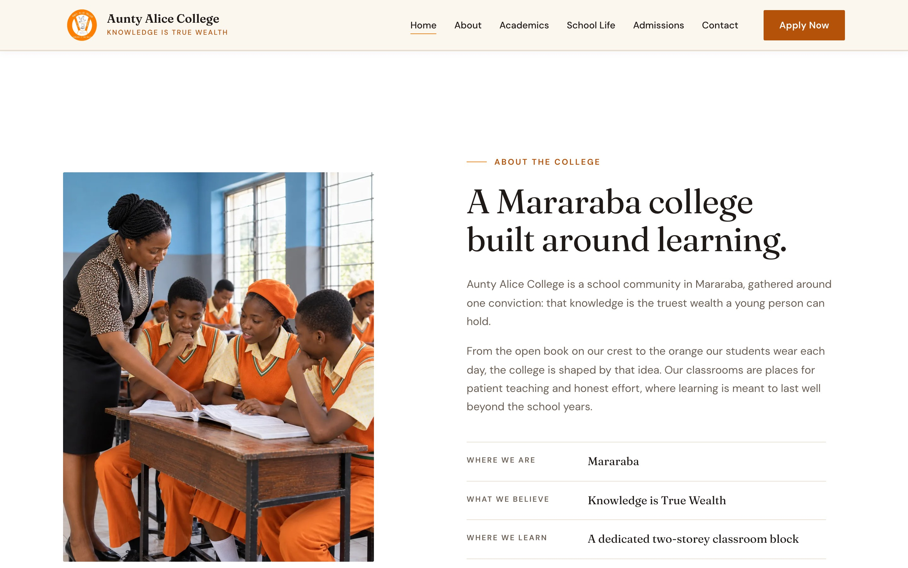</td>
  </tr>
  <tr>
    <td width="50%">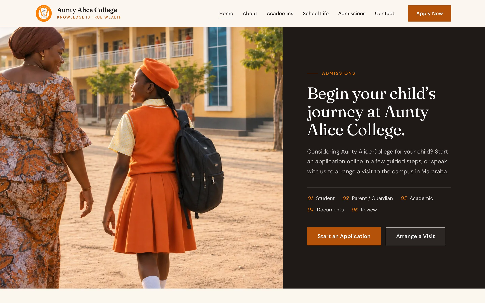</td>
    <td width="50%">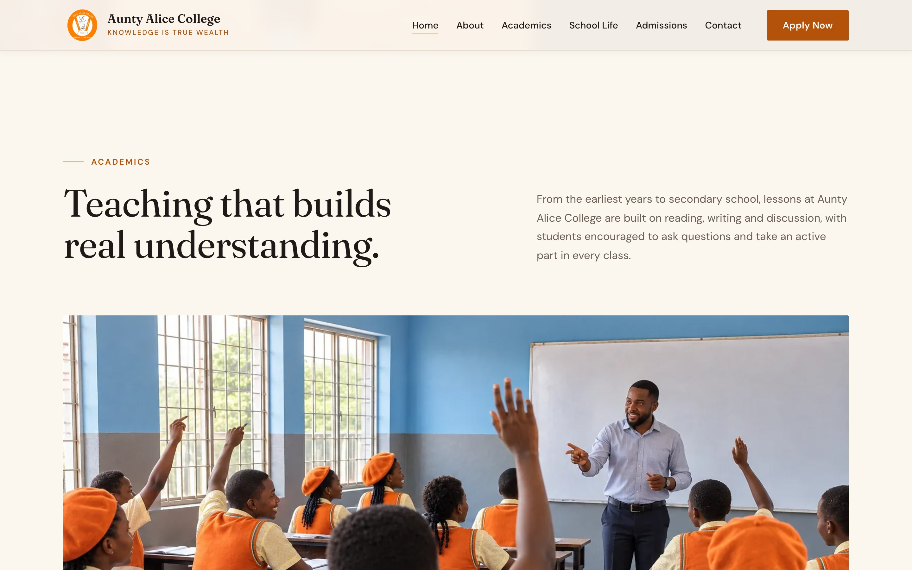</td>
  </tr>
  <tr>
    <td width="50%">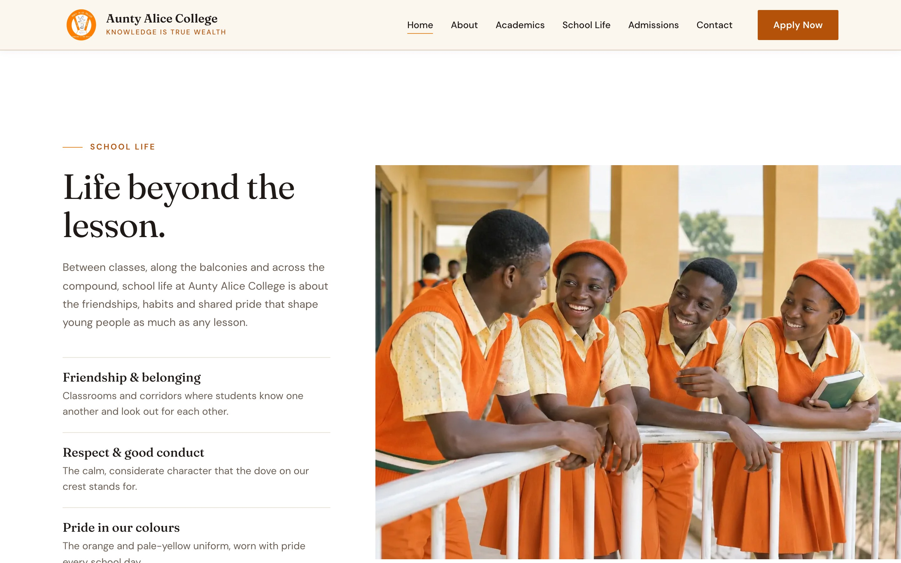</td>
    <td width="50%">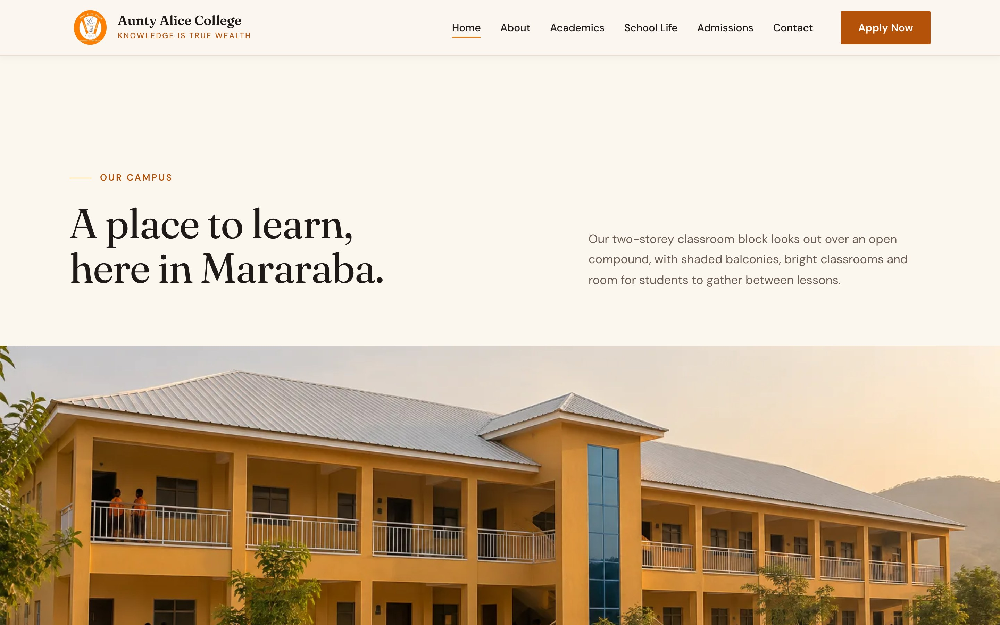</td>
  </tr>
</table>

---

## ◆ Design Philosophy

> **Warm light, true ground.**

- **Real place, better light.** The campus keeps its actual architecture, colours and furniture, just lit and composed beautifully.
- **Authentic content.** Built on what the school really is: its name, motto, crest and location. No invented awards, results or statistics.
- **Orange as a thread.** The uniform orange carries the brand through every frame, used with restraint.
- **Whitespace as structure.** Cream, ink and photography, with every section given room to breathe.
- **Responsive by design.** Each breakpoint is composed, not shrunk.
- **Accessible by default.** Keyboard navigation, visible focus, AA contrast and proper labels.
- **Subtle motion.** Gentle reveals and a soft fade at the video's loop point, with full reduced-motion support.

---

## ◆ Key Features

| | |
|---|---|
| 🎥 Full-viewport hero video with a soft fade at the loop | 🧭 Sticky header with in-page navigation |
| 📱 Full-screen mobile menu with focus trap | 🖼️ Edge-to-edge editorial image layouts |
| 📖 Educational philosophy from the school crest | 💻 Five-step demo admissions portal |
| 💾 Application drafts saved in the browser | ✉️ Validated newsletter sign-up (demo) |
| 🌗 Reduced-motion support | ♿ AA contrast and 44px+ touch targets |
| 🔒 No links to any external school site | 🪶 No frameworks, no build step |

---

## ◆ Responsive Experience

Designed and tested at five widths:

<div align="center">

`1440px` · `1366px` · `1024px` · `768px` · `390px`

</div>

- No horizontal overflow at any width
- Navigation that adapts from a full menu bar to a mobile menu
- Touch-friendly controls on small screens
- The hero video keeps the stairwell bay and students in frame on phones

<br>

<table>
  <tr>
    <td width="33%">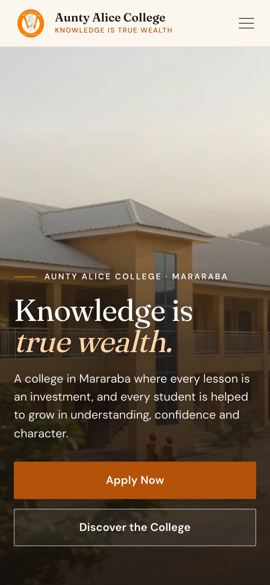</td>
    <td width="33%">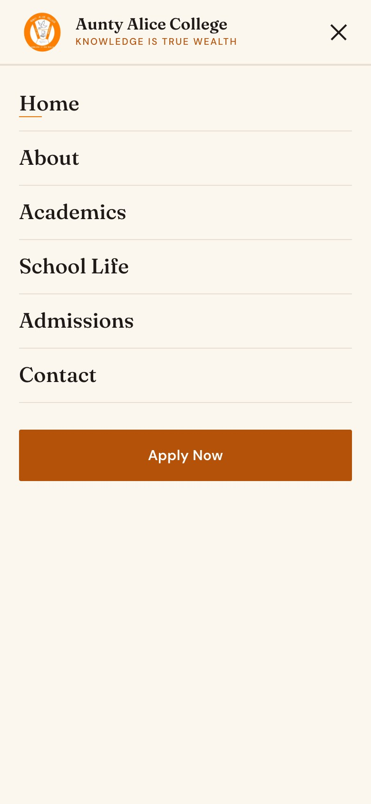</td>
    <td width="33%">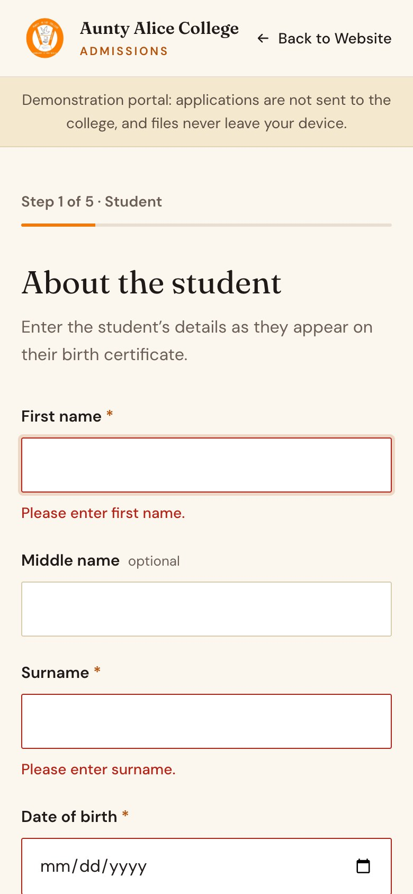</td>
  </tr>
</table>

---

## ◆ Technology

      

Hand-written HTML, CSS and vanilla JavaScript, with no framework and no build step. Typography pairs **Fraunces** for display with **DM Sans** for text. Images ship as WebP with JPEG fallbacks. Screenshots were captured with Puppeteer.

---

## ◆ Project Structure

```
auntyalice-premium-school-demo/
├── index.html              Homepage
├── admissions/
│   └── index.html          Demo admissions portal
├── assets/
│   ├── logo.png            Official school crest
│   ├── images/             Photography (WebP + JPEG fallbacks)
│   └── video/              Hero video
├── css/
│   ├── base.css            Design tokens, buttons, shared patterns
│   └── …                   One stylesheet per section
├── js/                     Header, hero video loop, reveals, newsletter, portal
├── docs/                   Discovery, asset log and QA report
└── screenshots/            Captures used in this README
```

---

## ◆ Demo Admissions Portal

Every **Apply** button opens a custom admissions experience at `/admissions`, never an external portal:

**Student** → **Parent / Guardian** → **Academic** → **Documents** → **Review** → **Complete**

It includes:

- inline, accessible validation
- document attachment with type and size checks
- a review step where each section can be edited
- drafts saved in the browser
- a demo application reference, such as `DEMO-2026-0001`

It shows how the college could handle online applications in future. **Nothing is submitted, uploaded or emailed.**

<br>

<table>
  <tr>
    <td width="50%">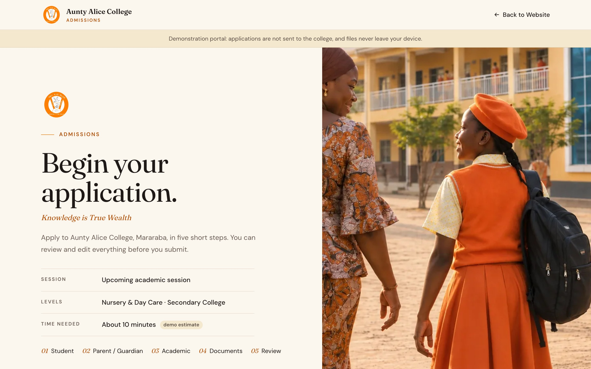</td>
    <td width="50%">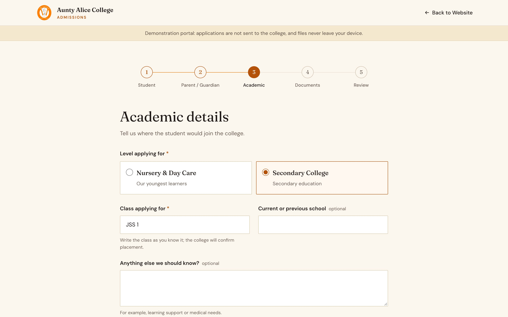</td>
  </tr>
  <tr>
    <td width="50%">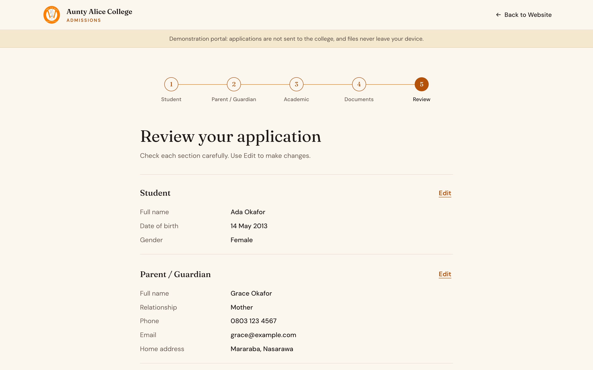</td>
    <td width="50%">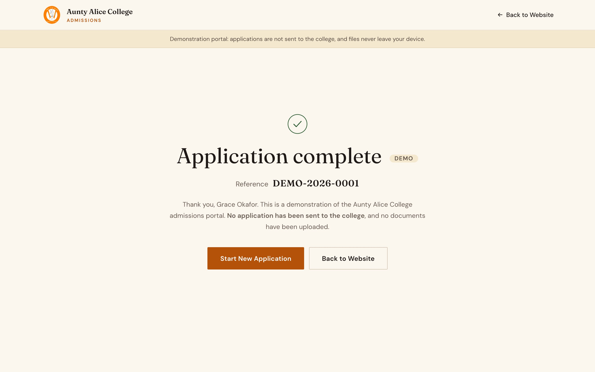</td>
  </tr>
</table>

---

## ◆ Design System

| Colour | Name | Hex |
|:---:|---|---|
|  | Alice Orange | `#F07A0A` |
|  | Burnt Orange | `#B5520A` |
|  | Uniform Green | `#2F5D34` |
|  | Laterite Ochre | `#E3C27A` |
|  | Harmattan Cream | `#FBF6EE` |
|  | Ink | `#1F1A17` |

The palette comes from the school's crest, the uniform and the ochre walls of the campus.

---

## ◆ Project Status

```
✓  Homepage complete
✓  Responsive layouts at five widths
✓  Navigation and mobile menu
✓  Admissions experience implemented
✓  Demo portal implemented
✓  Full-page QA passed
✓  GitHub repository established
```

---

## ◆ Run Locally

The site is static. Serve the folder so `/admissions` resolves:

```bash
python3 -m http.server 5180
```

Then open [http://localhost:5180](http://localhost:5180).

To deploy, publish only `index.html`, `admissions/`, `css/`, `js/` and `assets/`.

---

> [!NOTE]
> **About this demo.** This is a proposal website prepared for Aunty Alice College. It is not the school's production website.
>
> The crest is the school's own. The photography and hero video were generated to reflect the school's real uniform, colours and buildings; they are not photographs of actual students.
>
> Some details, such as contact information and the levels offered, are still to be confirmed by the college.

---

## ◆ Future Direction

Possible extensions, none of which exist yet:

- Verified contact details, levels and session dates from the college
- Real photography of the campus and students
- A real admissions backend
- A parent and student portal
- Newsletter service integration
- Additional pages for each level

---

<div align="center">

<br>

*Knowledge is true wealth, and every school deserves a digital presence that says so.*

<br>

<sub>Built with care for premium educational digital experiences.</sub>

<br><br>

</div>
